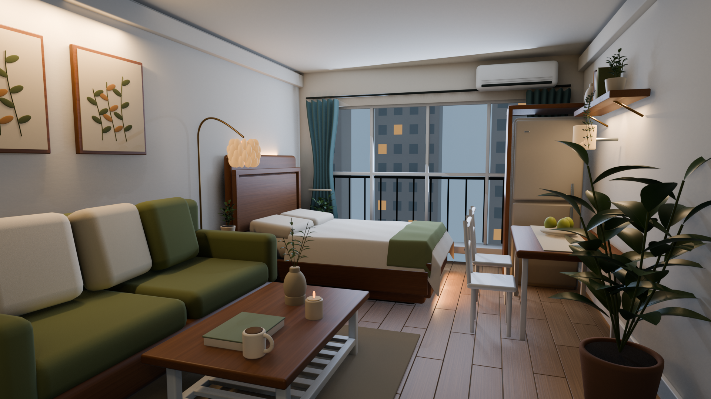
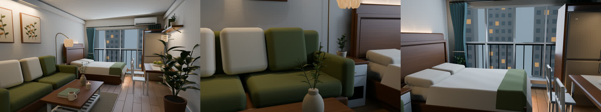

# Walnut Studio: an editable Blender restyle

Walnut Studio follows an interior scene from an existing Blender layout through
a walnut and olive material and lighting pass. The reference image sets the
mood. The room, camera, and scene hierarchy already exist, so the scripts change
those parts in place and let the same space be read from three camera positions.

The two images included here are project-result displays from that scene. They
document the look of the pass. The source `.blend`, base scene, reference image,
delivery archive, video, and frame cache stay out of this snapshot.

Read the full article in [ARTICLE.md](ARTICLE.md).





These images document the project result. They are included for this study and
are not open or stock image assets.

## What the method teaches

The workflow keeps several decisions visible:

1. The sofa, bed, dining area, window, and circulation stay in the existing
   layout, which gives the style pass a stable spatial read.
2. The scripts build a walnut and olive palette with procedural wood grain,
   quieter textile surface detail, warm ivory fabric, and small ceramic, brass,
   and plant accents.
3. A cool dusk window balances warm practical pools from the lamp, bed wall,
   gallery, shelf, and dining area.
4. Three authored moves cover the entrance, living textures, and window/dining
   reveal, so the material pass can be viewed from more than one angle.

The production path is reference, palette and material rules, native geometry
and styling, light balance, then camera checks. The room dimensions are
estimated from a single image, so the result is a visual scene study.

## Included in this snapshot

- `scripts/`: the production scripts used for material, geometry, camera,
  rendering, batching, scene organization, and film encoding.
- `media/01_overview.png`: the overview render from the completed scene.
- `media/contact_sheet.jpg`: the three-view contact sheet from the completed
  scene.
- `LICENSE`: PolyForm Noncommercial 1.0.0 for the included source and
  documentation.
- `THIRD_PARTY_NOTICES.md`: provenance and distribution boundaries.

The source `.blend`, the original `reference/base_scene.blend`, the reference
image, the delivery archive, the MP4, and the frame cache remain outside this
snapshot.

## Method scope and reproducibility

The scripts are extracts from the production workflow. They are useful for
inspection and adaptation. `style_walnut.py` opens
`reference/base_scene.blend`, which is outside this snapshot, so a clean
checkout needs a compatible base scene before it can rebuild the room.

With Blender 5.1.1 and a compatible base scene at
`reference/base_scene.blend`, the documented commands are:

```sh
blender -b -t 6 --python scripts/style_walnut.py
python3 scripts/render_batches.py
blender -b Walnut_Studio.blend -t 6 --python scripts/render.py -- stills
./scripts/encode_film.sh
```

If Blender is not on `PATH`, set `BLENDER_BIN` to the executable for your own
machine before running `scripts/render_batches.py`.

The first command creates the edited `.blend` and QA previews. The next two
render film frames and stills. The final command encodes a film from those
frames. This snapshot contains no film file.

## Evidence and limits

The overview and contact sheet are project outputs copied without recompression.
They show the walnut and olive palette, the dusk and practical lighting, and
the three camera viewpoints. The scripts document the production method. This
release contains no verified film or timing measurement.

Some furniture and plant forms remain procedural and stylized. The result is a
visual scene study rather than a construction drawing.

## License scope

The PolyForm Noncommercial 1.0.0 terms in `LICENSE` apply to the included
scripts and this README. The renders are included as project-result displays.
No separate license to reuse them as stock or open image assets is granted.
The terms do not grant rights to the excluded Blender scene, base scene,
reference image, delivery video, or any third-party material.

The distribution is source-available and noncommercial. PolyForm Noncommercial
is outside the OSI-approved open-source licenses.
